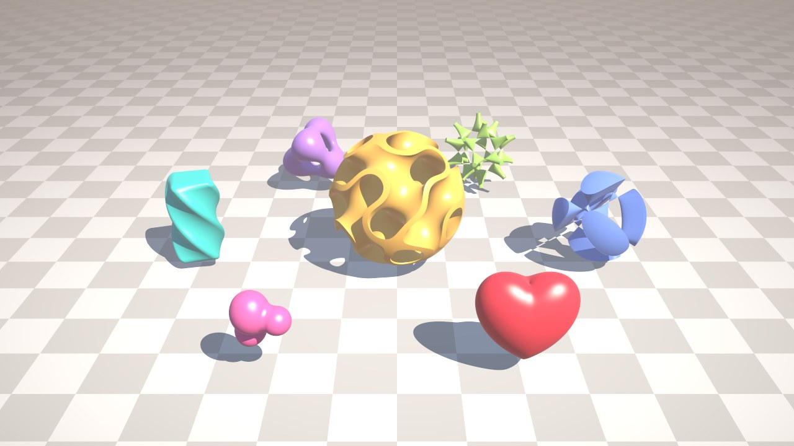

<p align="center">
  
</p>

<p align="center">
  <a href="LICENSE"></a>
  <a href="#installation"></a>
  <a href="#installation"></a>
  <a href="#examples"></a>
  
  
</p>

**vusvna** (Vulkan Self-Validated Numerical Analysis) is a [Slang](https://shader-slang.org) module
providing computations with **guaranteed error bounds** in Vulkan shaders. It implements
[affine arithmetic](https://en.wikipedia.org/wiki/Affine_arithmetic) (AA), a model that keeps track of the
correlations between quantities and therefore yields much tighter bounds than interval arithmetic on long
computations. It is the Vulkan port of [cusvna](https://github.com/keckj/cusvna).

* **Rigorous**: the exact real result of a computation always lies within the computed bounds, including
  floating point rounding errors, under the weak guarantees of the Vulkan specification (no directed
  rounding, no infinities nor NaNs, denormals flushed, possible fused multiply-adds).
* **GPU friendly**: no dynamic allocation, affine forms are small fixed-size structs living in registers.
  Works in any shader stage: compute, ray tracing (intersection shaders), fragment...
* **Generic**: functions written once for a type `T : IReal` are evaluated on affine forms to bound them
  and on floats to compute their values.

Typical applications are robust root isolation and subdivision schemes (quadtrees, octrees), ray tracing
of implicit surfaces and level sets, and any numerical method that must not miss a solution.

<p align="center">
  
</p>

## Example

```slang
import vusvna;

typealias AA2 = AA<2>;

/* the unit circle, generic over the number type */
T circle<T : IReal>(T x, T y) { return sqr(x) + sqr(y) - 1.0; }

/* returns false only if the unit circle certainly does not cross the box X x Y */
bool may_contain_root(Interval X, Interval Y) {
    const AA2 x = AA2::variable(0, X);   /* input k gets noise symbol k */
    const AA2 y = AA2::variable(1, Y);
    return possibly_zero(circle(x, y));  /* circle(x, y) is guaranteed to lie in its interval() */
}

/* the same function evaluated on floats */
float circle_value(float x, float y) { return circle(Real(x), Real(y)).v; }
```

The generic operators and functions are not defined for `float`, so that they never shadow the builtin
functions: floats are wrapped into `Real` (field `v`) to call generic code.

## Installation

vusvna is distributed as Slang source: add the `vusvna` directory of this repository (the directory that
contains `vusvna.slang`) to the include paths of the Slang compiler and write `import vusvna;`.

With [slangpy](https://github.com/shader-slang/slangpy):

```python
import slangpy as spy

device = spy.Device(type=spy.DeviceType.vulkan,
                    compiler_options=spy.SlangCompilerOptions({"include_paths": ["path/to/vusvna/vusvna"]}))
```

Requirements:

* a Vulkan device, with hardware ray tracing for examples 04 and 05,
* Slang (tested with the compiler shipped with slangpy 0.43),
* **no fast math** options, see [Guarantees](#guarantees).

## Affine arithmetic in vusvna

An affine form represents an unknown real quantity as

    x = b + x_1 e_1 + ... + x_N e_N + e,      e_i unknown in [-1, 1],  |e| <= err

The noise symbols `e_i` are shared between forms and carry correlations: `x - x` is exactly zero, while
interval arithmetic would return `[-2r, 2r]`.

vusvna uses **reduced affine arithmetic** (AF1): `AA<N>` stores exactly `N` coefficients, one per input
variable created with `AA<N>::variable(k, interval)`. Nonlinear operations approximate their result by an
affine function of their input, and their approximation errors, as well as all rounding errors, are
accumulated in the independent term `err`. Forms therefore never grow and cost `N + 2` floats, but the
correlations of these errors are lost: `sqr(x) - sqr(x)` is not zero but an interval whose radius is twice
the error term of `sqr(x)`. cusvna instead creates a new noise symbol for each nonlinear operation and keeps all correlations,
at the cost of larger forms and of a runtime tag per symbol.

* `AA<N>::variable(k, I)`: the input variable of symbol `k` (`0 <= k < N`), taking all values of `I`.
* `AA<N>::from_interval(I)`: a quantity taking any value of `I`, uncorrelated with everything else.
* `AA<N>(c)`, `AA<N>::entire()`: constants and the form representing any real number.
* `x.interval()`, `x.sign()`, `x.affine_range()`, `x.radius()` (sum of the `|x_i|`, without `err`),
  `x.magnitude(k)`, `x.is_entire()`: conversions back to intervals.

## Supported operations

| Operations | Notes |
|---|---|
| `+`, `-`, `*`, `/` between forms and with floats | |
| `sqr(x)`, `pown(x, int n)` | `sqr(x)` is tighter than `x*x` |
| `reciprocal(x)` | min-range approximation, entire if `0` belongs to `x` |
| `sqrt(x)`, `rsqrt(x)`, `cbrt(x)` | `sqrt` is evaluated on the part of its input where `x >= 0` |
| `pow(x, float y)` | for `x >= 0` (`x > 0` if `y < 0`) |
| `pow(x, y)` with an affine exponent | `exp(y*log(x))`, for `x > 0` |
| `exp(x)`, `exp2(x)`, `log(x)`, `log2(x)` | |
| `sin(x)`, `cos(x)`, `tan(x)`, `atan(x)` | `tan` is entire if a pole belongs to `x` |
| `abs(x)`, `positive_part(x)` | `positive_part(x) = max(x, 0)` |
| `min(x, y)`, `max(x, y)`, `clamp(x, lo, hi)` | `(x + y -+ abs(x - y))/2` |
| `hypot(x, y)`, `hypot(x, y, z)`, `rhypot` | |
| `lerp(a, b, t)`, `smoothstep(e0, e1, x)` | |
| `smooth_min(a, b, k)`, `smooth_max(a, b, k)` | polynomial smooth minimum of distances |
| `certainly_lt`, `certainly_le`, `certainly_gt`, `certainly_ge`, `possibly_zero` | rigorous predicates |
| `join`, `intersect`, `contains`, `subset`, `is_empty`, `+`, `-`, `*`, `/`, `sqr`, `sqrt`, `abs` | on `Interval` |

All of them are generic over `T : IReal` and also work on `Real`. The other functions of cusvna (`asin`,
`acos`, `atan2`, hyperbolic functions, `erf`, `tgamma`, `floor` and friends, `fmod`, `remainder`, ...) are
not ported yet.

## Guarantees

For any operation, the exact real result of the computation belongs to the range of the computed form,
including rounding errors. In particular `x.interval()`, `x.sign()` and the predicates are rigorous.

Vulkan gives few guarantees on floating point arithmetic, and vusvna only relies on the following ones:

* additions, subtractions and multiplications are correctly rounded to nearest, divisions, square roots and
  transcendental functions are within the error bounds of the Vulkan specification ("Precision and
  Operation of SPIR-V Instructions"),
* denormals may be flushed to zero on input and output of any instruction,
* the compiler may contract `a*b + c` into a fused multiply-add,
* the implementation may assume that **no infinity nor NaN** is ever produced. Drivers do exploit it: on
  NVIDIA `isinf(+inf)` is false and `NaN == NaN` is true.

As a consequence:

* **No infinities nor NaNs**: all magnitudes are kept below `2^60`, so that products and sums of products
  cannot overflow, and larger quantities mean "any real number" (entire forms). Entire forms propagate
  through all operations, except through bounded functions such as `sin`.
* **Rounding**: error-free transformations (TwoSum, TwoProd) cannot be trusted when the driver may fuse
  operations. Rounding errors are bounded with the standard model `|r - x| <= k ulp(x) + 2^-126`, where
  `k = 1/2` for correctly rounded operations, `k` is the documented bound otherwise, and `2^-126` accounts
  for flushed denormals. A fused multiply-add only removes a rounding, the bounds remain valid.
* **Nonlinear functions**: the residual `f(x) - alpha*x` is bounded with outward rounding by splitting the
  input range into pieces where `f` is convex or concave, from rigorous enclosures of `f` and `f'` at
  points. These enclosures use the bounds of the specification for `exp`, `exp2`, `log`, `log2` and `atan`.
  `sin` and `cos` (only guaranteed to `2^-11` by the specification) are computed by vusvna with a
  Cody-Waite reduction and Taylor polynomials, `cbrt` (not in SPIR-V) with a Newton step validated by
  cubing its bounds.
* **Domains**: if an input range is not entirely inside the domain of a function, the result is entire,
  except for `sqrt` and `pow(x, float y)` which are evaluated on the part of their input inside their domain
  when it is not empty.

Do not compile vusvna code with the fast floating point mode of the Slang compiler (`-fp-mode fast`).

## Examples

The `examples` directory contains Python scripts that compile the Slang shaders of `examples/shaders` at
runtime and run them with slangpy:

| Script | Description |
|---|---|
| `00_1d.py` | enclosures of a 1D function on refined subdivisions |
| `01_2d.py` | sign classification of a 2D function on refined grids |
| `02_quadtree.py` | adaptive quadtree refinement around the zero level set of a 2D function |
| `03_octree.py` | adaptive octree refinement around an implicit surface, meshed with marching cubes |
| `04_raytracing.py` | ray tracing of implicit surfaces with Vulkan ray tracing (procedural primitives) |
| `05_levelset.py` | interactive viewer of animated level sets |

```sh
git clone https://github.com/keckj/vusvna.git
pip install -r vusvna/examples/requirements.txt
python vusvna/examples/02_quadtree.py
```

`04_raytracing.py [output.png]` saves the image when a file name is given. `05_levelset.py` opens a window,
or renders offscreen with `--output image.png` (see `--help` for the time, mode, method, samples and size).
The level sets are found by marching along the rays with affine forms of the ray parameter, either by a
sign test on the interval of the function or with a root window that skips the parts of the ray where the
affine form proves that there is no root. The shapes cast shadows and are antialiased by accumulating
jittered samples while the scene is paused.

| Key | Action |
|---|---|
| `ENTER` | rendering mode: shaded, normals, marching steps |
| `M` | marching method: sign test, root window |
| `A` | samples per pixel |
| `SPACE` | pause the animation (images accumulate while paused) |
| `+`/`-`, `UP`/`DOWN` | animation speed |
| left / right mouse button, wheel | orbit, look around, zoom |
| `Q`, `ESC` | quit |

### Comparison with cusvna

On an RTX 5090, with the same scenes and settings as the cusvna examples:

| Example | vusvna | cusvna |
|---|---|---|
| `03_octree.py`, level 11 (20M active cells) | 1.1 ms | 12 ms |
| `03_octree.py`, level 12 (81M active cells) | 5 ms | 54 ms |
| `05_levelset.py`, 1024x768, 1 spp, shaded | 2.2 ms | 29 ms |
| `05_levelset.py`, 1024x768, marching steps | 1.6 ms | 18 ms |

The images of `04_raytracing.py` match those of cusvna (no pixel differs by more than 8/255), and less than
1% of the pixels of `05_levelset.py` differ by more than 16/255. The quadtree has the same active cells as
cusvna up to level 12 (deeper levels keep more cells because the coordinates of the cells are single
precision floats), the octree keeps 0.05% more cells at level 12. The reduced arithmetic loses the correlations of the nonlinear errors
and needs a few more marching steps on some shapes, but each step is much cheaper.

## Tests

The tests check on the GPU that the enclosures of all operations contain the values of the functions,
computed in double precision on many sample points of random input intervals (narrow, wide and
degenerate), and report the median ratio between the computed and sampled widths
(between 1.0 and 1.2 for most operations).

```sh
pytest tests                  # or: python tests/test_vusvna.py for a report
```

## License

vusvna is released under the [MIT License](LICENSE).
